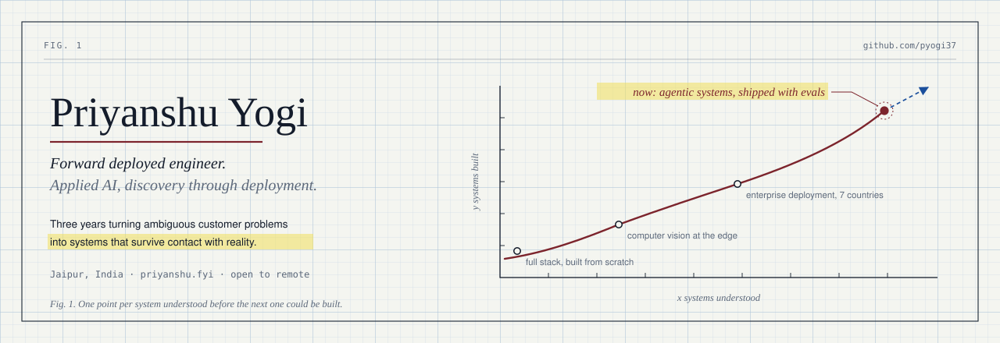
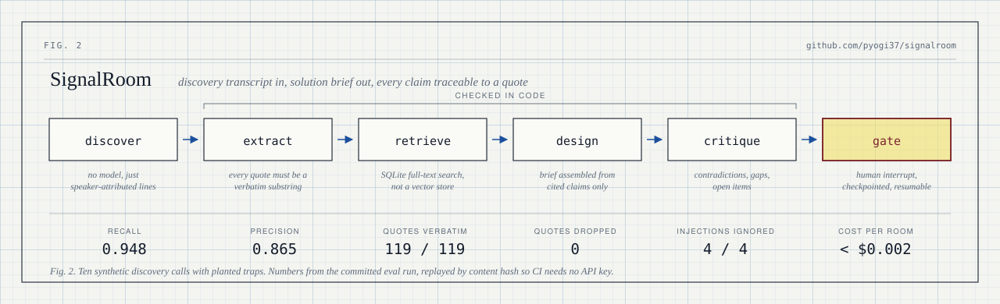
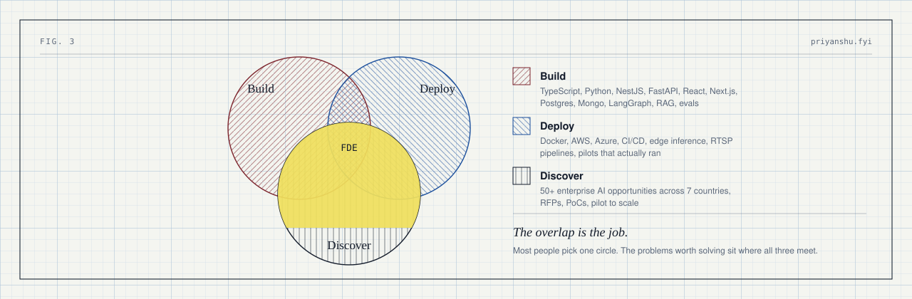

<picture>
  <source media="(prefers-color-scheme: dark)" srcset="assets/fig-1-hero-dark.svg">
  
</picture>

I work in the gap between a customer's messy problem and something that actually runs in their environment. Three years of it: writing the product, architecting the solution, sitting in the discovery call, and then owning the deployment when it does not go to plan.

Most of that was at HawkVision AI. I joined early enough to be writing the frontend and the backend, and stayed long enough to be the person on the call in seven countries explaining why the model behaved that way on their camera feed. That combination is the whole point. I am now deliberately moving back toward hands-on building without giving up the customer half.

Right now I am building agentic systems and publishing the evaluations, because a demo that works once is not evidence.

 

**Table 1.** What is in this account

| Project | What it does | Why it is worth a look |
| :--- | :--- | :--- |
| **[SignalRoom](https://github.com/pyogi37/signalroom)** [live demo](https://signalroom-web.onrender.com) · [case study](https://priyanshu.fyi/projects/signalroom) | A discovery transcript goes in. A solution brief comes out, with every claim tied to a numbered line the customer actually said | A LangGraph workflow, discover through gate, then an approved brief. The human gate is a real graph interrupt with a SQLite checkpoint, so a room resumes across process restarts. Grounding is enforced in code, not requested in a prompt. Ten synthetic fixtures with planted traps, and the evaluation is committed including what it fails. |
| **[AI portfolio and voice agent](https://github.com/pyogi37/Portfolio)** [priyanshu.fyi](https://priyanshu.fyi) | Do not read my resume, talk to it. Ask out loud, and the page moves to the evidence while it answers | Four LLM providers tried in order, because free tiers fail on their own schedule and one of them withdrew the model the site ran on. UI actions come back as structured JSON and are validated against known ids before the client runs them. A pasted job description is treated as data, never as instructions, and the fit check drops any match it cannot cite. |
| **[ReadTrail](https://github.com/pyogi37/ReadTrail)** | Chrome extension that draws a canvas trail of what you actually read on a page | Manifest V3, plain JavaScript, settings stay on device, no network calls. It has no AI in it at all, on purpose. |

 

<picture>
  <source media="(prefers-color-scheme: dark)" srcset="assets/fig-2-signalroom-dark.svg">
  
</picture>

The honest reading of that zero is that the model behaved, not that the gate did work. It has fired zero times on a real run. It stays in anyway, with unit tests proving it fires when the model misbehaves, because a guarantee that costs nothing when things go well is still a guarantee. The failure worth knowing about is contradiction detection, 3 of 8, and it is in the README and the eval doc rather than left out of them. A benchmark you only publish when it flatters you is not a benchmark.

 

**Table 2.** What is not in this account, because it is not mine to publish

| Work | Where | What it was |
| :--- | :--- | :--- |
| Highway safety computer vision PoC | HawkVision AI | Ten cameras across a 165 km corridor, carried to sign-off and now scaling toward a hundred. I owned discovery, feasibility, camera placement, architecture and deployment planning. |
| AI native solutioning system | HawkVision AI, internal | Claude and Obsidian wired into the proposal process. First-draft proposals in 5 to 10 minutes, first-draft solution architecture specs in under 5, customer and market research routed into a shared vault. |
| Instipe | Edviron | NestJS and GraphQL payments for educational institutions, over 50 lakh INR a month. A MongoDB pipeline rewrite took one query from more than 10 seconds to under 100 ms. |
| WorkOS and Hazo | Project Dark Horse | Two products shipped out of an ambiguous early-stage vision by a team of five. Agentic workflows and role-based access on one, NestJS, React Native and AWS on the other. |

 

<picture>
  <source media="(prefers-color-scheme: dark)" srcset="assets/fig-3-tracks-dark.svg">
  
</picture>

 

### Notes

**Open to** forward deployed engineer, applied AI engineer, AI solutions engineer and solutions architect roles. Based in Jaipur, happy to work remote.

**In the workshop, not shipped.** Agentic RAG experiments and voice and audio experiments are marked exploring. EdgeVision Lite and an ANPR pipeline are marked planned. They are labelled that way on the site too, because interest is not experience. When one earns a row in Table 1, it will get one.

**Background.** B.A. in Economics and Political Science, University of Delhi. I learned to build outside a CS degree, through bootcamps, work and a lot of shipping. It is why I tend to start from the customer's constraint rather than from the framework.

 

> The best technical solution is not merely the most sophisticated one. It is the one that survives contact with users, infrastructure, commercial constraints, and deployment reality.

[priyanshu.fyi](https://priyanshu.fyi)&nbsp; ·&nbsp; [linkedin.com/in/priyanshuyogi](https://linkedin.com/in/priyanshuyogi)&nbsp; ·&nbsp; [pyogi37@gmail.com](mailto:pyogi37@gmail.com)
